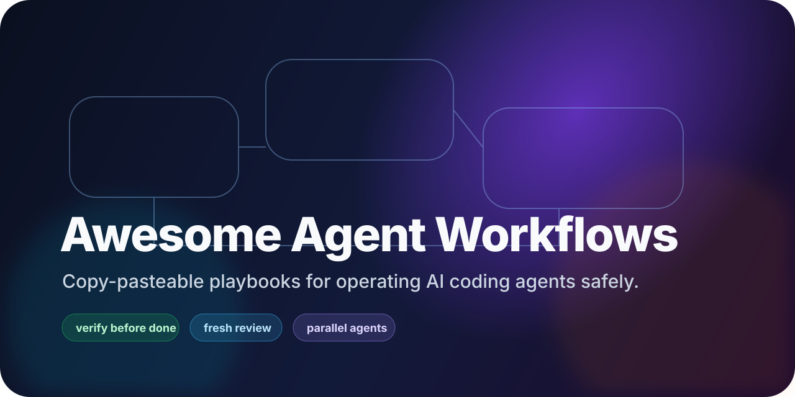
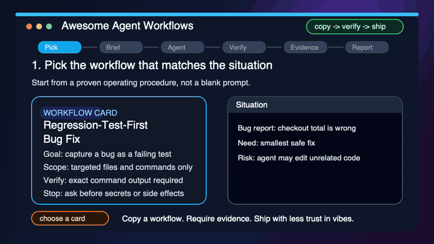

# Awesome Agent Workflows

> Copy-pasteable workflows for shipping real work with AI coding agents, CLI agents, and autonomous development tools.

[](https://awesome.re)
[](LICENSE)



AI agents are powerful, but most examples stop at toy prompts. This repo collects **operational workflows**: how to hand off a task, constrain an agent, verify its work, recover when it drifts, and ship without trusting vibes.

This is not an agent framework. It is not a prompt dump. It is a library of practical operating procedures for people using Claude Code, Codex CLI, Cursor agents, Aider, OpenCode, Gemini-style agents, local agents, LangGraph/CrewAI systems, or custom tool-using assistants.

**Every card says how far it has been proven.** 14 are **field-tested**, distilled from running up to ten coding-agent sessions at once in a one-person studio. 1 is a reviewed **candidate**. 26 are still **drafts** on a generic template. Turning a draft into a real card is the most useful contribution: see [CONTRIBUTING](CONTRIBUTING.md).

**Search and filter every card at [richicinschi.github.io/awesome-agent-workflows](https://richicinschi.github.io/awesome-agent-workflows/).**

## Start here by situation

- **I have a vague feature request** → [Spec → Plan → Implementation](workflows/01-spec-to-plan.md)
- **I want to run agents in parallel** → [Parallel Agent Development](workflows/02-parallel-agent-development.md) + [Git Worktree Agent Lanes](workflows/35-git-worktree-agent-lanes.md)
- **The agent says it fixed a bug, but I do not trust it** → [Regression-Test-First Bug Fix](workflows/13-regression-test-first-bugfix.md) + [Fresh-Context Code Review](workflows/04-fresh-context-code-review.md)
- **An agent added tests, but I do not trust the coverage** → [Agent-Generated Test Review](workflows/41-agent-generated-test-review.md)
- **CI failed after an agent change** → [CI Red-to-Green Reproducer](workflows/19-ci-red-to-green.md)
- **Tests are flaky** → [Flaky Test Burn-Down](workflows/20-flaky-test-burndown.md)
- **I am about to merge AI-generated code** → [Agent Patch Intake Triage](workflows/16-patch-intake-triage.md) + [Fresh-Context Code Review](workflows/04-fresh-context-code-review.md)
- **I am changing APIs or schemas** → [API Contract Change Lockstep](workflows/18-api-contract-lockstep.md)
- **I am doing a public release** → [Release Runbook](workflows/07-release-runbook.md) + [Secrets and Config Audit](workflows/38-secrets-config-audit.md)
- **I am launching a public repo** → [Repo Growth Launch](workflows/10-repo-growth-launch.md)
- **A long session is about to compact or hand off** → [Context Compaction and Handoff](workflows/36-context-compaction-handoff.md)

## Quick start

1. Pick the workflow that matches your situation.
2. Copy the **Agent brief** into your agent tool.
3. Fill in the bracketed variables.
4. Run the verification steps before merging, deploying, or reporting success.

```text
Goal: Add a workflow card for fresh-context code review.
Scope: README.md, workflows/, templates/, docs/ only.
Non-goals: Do not change CI, repo settings, secrets, or unrelated files.
Verification: Run python3 scripts/lint_repo.py and report the exact output.
Stop conditions: Ask before publishing, deleting files, or changing repository settings.
```



The demo uses a synthetic public-safe storyboard to show the core loop: choose a workflow, paste a bounded brief into any agent, require verification evidence, then report files changed and remaining risks.

Start with [`templates/agent-brief.md`](templates/agent-brief.md), then browse the full catalog in [`docs/WORKFLOW-CATALOG.md`](docs/WORKFLOW-CATALOG.md).

## Install as agent skills

The field-tested and candidate cards also ship as skills, so your agent can follow a workflow without you pasting it.

**Claude Code** (2.1.275 or later):

```text
/plugin install agent-workflows --marketplace Richicinschi/awesome-agent-workflows
```

On older versions, run `/plugin marketplace add Richicinschi/awesome-agent-workflows`, then `/plugin install agent-workflows@awesome-agent-workflows`. Start a workflow with, for example, `/agent-workflows:fresh-context-code-review`.

**Codex CLI and other agents that read `SKILL.md`:** copy the folders in [`plugin/skills/`](plugin/skills/) into `~/.agents/skills/`, or into `.agents/skills/` inside your repo.

The skills are generated from the cards by `scripts/build_skills.py`, so the cards stay the single source.

## Workflow library

The library has **41 workflow cards**. Start with the field-tested ones:

- [Spec → Plan → Implementation](workflows/01-spec-to-plan.md): drill a vague request into a decision-resolved spec before any code.
- [Agent Task Contract and Scope Box](workflows/12-agent-task-contract.md): delegate with goal, scope, non-goals, verification and stop conditions.
- [Parallel Agent Development](workflows/02-parallel-agent-development.md): split work across agents without them colliding.
- [Git Worktree Agent Lanes](workflows/35-git-worktree-agent-lanes.md): one lane per agent, shared surfaces changed only through worktrees.
- [Fresh-Context Code Review](workflows/04-fresh-context-code-review.md): one independent review, handed the raw files instead of the author's summary.
- [Regression-Test-First Bug Fix](workflows/13-regression-test-first-bugfix.md): prove the test fails before the fix.
- [CI Red-to-Green Reproducer](workflows/19-ci-red-to-green.md): trust counts against a baseline, not the colour of the check.
- [Long-Running Task Checkpoint](workflows/40-long-running-task-checkpoint.md): run long jobs where the logs survive and silence is an alarm.
- [Context Compaction and Handoff](workflows/36-context-compaction-handoff.md): hand off a long session without losing decisions.
- [Agent Memory Hygiene Review](workflows/32-agent-memory-hygiene-review.md): keep agent memory true; archive, never silently delete.
- [MCP and Tool Integration Review](workflows/37-mcp-tool-integration-review.md): scan and review a tool or skill before an agent may load it.
- [Secrets and Config Audit](workflows/38-secrets-config-audit.md): audit the whole git history before a public push.
- [Research Brief](workflows/08-research-brief.md): design the search so it can find what would prove you wrong.
- [Repo Growth Launch](workflows/10-repo-growth-launch.md): launch a public repo honestly, written from this repo's own launch.

The other cards, with their status, are in the [catalog](docs/WORKFLOW-CATALOG.md). For machine-readable metadata, including each card's status and the evidence that proves it worked (for drafts, the target a rewrite must meet), see [`agent-workflows.json`](agent-workflows.json).

## Tool adapters

Use the same workflows with different agents:

- [Claude Code](docs/tools/claude-code.md)
- [Codex CLI](docs/tools/codex-cli.md)
- [Cursor agents](docs/tools/cursor.md)
- [Aider](docs/tools/aider.md)
- [OpenCode](docs/tools/opencode.md)
- [Local/self-hosted agents](docs/tools/local-agents.md)
- [Agent tool comparison matrix](docs/tools/comparison-matrix.md)

## Worked examples

- [Fresh-context review catches an unverified PR](examples/fresh-context-review-catches-unverified-pr.md): using a workflow to catch an agent’s unverified completion claim, end to end.
- [Diff review catches agent scope drift](examples/agent-scope-drift-caught-by-diff-review.md): the agent finished the task but also edited unrelated files.
- [Agent claims tests passed without running them](examples/agent-claims-tests-passed.md): the verification gate that turns "tests pass" into evidence.

### Field stories

Real incidents from a one-person studio running up to ten coding-agent sessions at once, each with the guardrail that came out of it:

- [A guardrail built for one agent became a 90% false alarm at ten](examples/field-story-one-guardrail-ten-agents.md): why hub-wide checks break under parallel agents, and the recency rule that fixed it.
- [Eight ways a green test suite proved nothing](examples/field-story-tests-that-cannot-fail.md): tests that could not fail, every one caught by review or mutation testing, none by the suite.
- [When the verification evidence itself was wrong](examples/field-story-verification-evidence-lied.md): pipes that ate exit codes, swallowed summaries, and 17 tests that silently became skips.

## What makes a workflow good?

A good workflow is:

- **portable** — works across tools, not just one vendor;
- **bounded** — says what the agent may and may not touch;
- **observable** — defines evidence before success claims;
- **recoverable** — has stop conditions and rollback steps;
- **short enough to use** — copyable in a real session.

## Contributing

Contributions are welcome. Please add workflows that are practical, tested, and vendor-neutral when possible.

Good contributions include:

- a workflow you have used on a real repo;
- a failure mode and the guardrail that prevented it;
- a reusable agent brief template;
- a launch, QA, review, or debugging checklist;
- a link to a high-quality public resource with a short explanation.

Read [`CONTRIBUTING.md`](CONTRIBUTING.md) and [`docs/curation-policy.md`](docs/curation-policy.md) before opening a PR.

## Public launch plan

The ethical growth plan lives in [`docs/launch/GROWTH-PLAN.md`](docs/launch/GROWTH-PLAN.md). It explicitly avoids paid, fake, or bot engagement. If this repo helps, share it with people building with agents and star it so others can find it.

## License

MIT — see [`LICENSE`](LICENSE).

## Disclaimer

This repository is community-maintained and not affiliated with Anthropic, OpenAI, Cursor, Aider, SST/OpenCode, LangChain, CrewAI, or any other vendor mentioned here.
